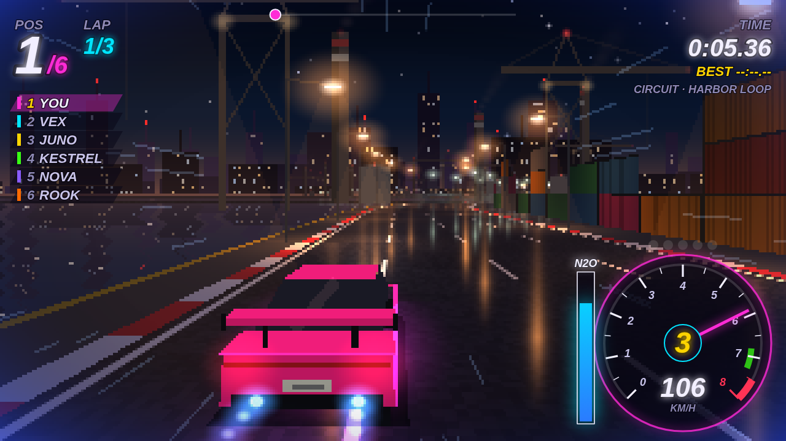

# Midnight Machines

An original night street racer — circuit, sprint and drag — that runs in the browser as WebAssembly, with
multiplayer rooms on Cloudflare Workers. Built from scratch: no code, data, names, cars, tracks or music from any
other game. Everything is simulated and drawn in code.

Style follows [tempoxyz/zempo](https://github.com/tempoxyz/zempo): Zig 0.16.0, TigerStyle, deterministic
simulation testing (DST), zero dependencies.



## Build and test

```sh
./zig/download.sh            # fetches Zig 0.16.0 into ./zig (checksummed)
./zig/zig build test         # unit tests
./zig/zig build dst -- --seeds 3000   # deterministic simulation testing
./zig/zig build wasm         # zig-out/bin/machines.wasm + web/machines.wasm (~67 KB)
```

Play locally: serve `web/` with any static server (`python3 -m http.server -d web`) for single races, or run the
Worker for multiplayer: `cd worker && npm ci && npx wrangler dev --config ../wrangler.jsonc`.

Controls: ↑/W gas, ↓/S brake, ←→/A D steer, Shift/N nitrous, E/Q shift up/down, Esc pause, M sound. Gamepads work.

## How it works

- **Simulation** (`src/sim.zig`): integer fixed-point only — no floats, no clock, no randomness beyond the seeded
  PRNG. Gears, shift quality, nitrous, bots, crashes. 60 Hz fixed tick. Eight procedural tracks (`src/track.zig`).
- **Renderer** (`src/render.zig`): pseudo-3D road, scenery, rain and neon into a 320×180 framebuffer, ~2.5 ms/frame
  in wasm. It only reads sim state.
- **Wasm** (`src/wasm.zig`): `mm_*` exports, no imports, no allocation after init.
- **Multiplayer** (`worker/`): one Durable Object per room runs the same wasm as the clients. Lockstep: clients
  send inputs, the room orders them into frames, everyone simulates the same ticks and compares `mm_hash()`.
  See [docs/MULTIPLAYER.md](docs/MULTIPLAYER.md).
- **DST** (`src/dst.zig`): replicas over a seeded lossy, reordering network with resends; checks every replica's
  hash agrees, invariants hold, and mutations are caught. See [docs/DST.md](docs/DST.md).
- **Tempo fuel** (`?tempo`): optional nitrous refills paid per use over an MPP session on Tempo testnet
  (`worker/pump.js`, `web/fuel.js`). The only dependencies in the repo (mppx, viem) live here — see
  [docs/DEVIATIONS.md](docs/DEVIATIONS.md).

## Deploy

```sh
./zig/zig build wasm
cd worker && npm ci && npx wrangler deploy --config ../wrangler.jsonc
```

Tests of the deployed Worker: `MM_URL=https://… node --test test/`.

Design spec: [SPEC.md](SPEC.md). Renderer notes: [docs/RENDER.md](docs/RENDER.md).

